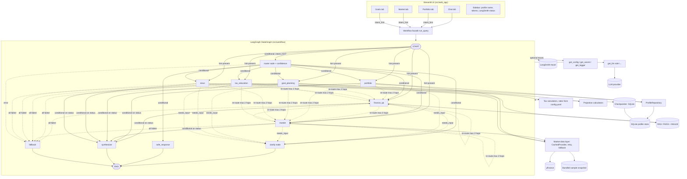

# AI Finance Assistant: Architecture

Scope tags: **[MVP]** = built in the 2-week scope. **[Later]** = designed for, not built now.
Agents use a separate **build status** (build first / build after); all six are designed into the graph now.
All settings live in `config.yaml` and are read via `get_config()`; secrets via `get_secret()`.
Model IDs live in `config.yaml` and are verified by `python smoke_test.py`.

---

## 1. Component diagram



**Why:** the UI only talks to one facade, the graph only talks to agents, and agents only reach the outside world through tools, the repository and `get_llm()`. Each layer can be mocked in tests.

---

## 2. Agents

All agents extend `BaseAgent` (section 3). Every agent provides information and education. None gives a personalised buy/sell/hold recommendation.

| # | Agent | Build status | Deterministic tool |
|---|---|---|---|
| 2.1 | Finance Q&A | build first | none (RAG retriever) |
| 2.2 | Portfolio Analysis | build first | metric functions |
| 2.3 | Market Analysis | build first | market data layer |
| 2.4 | Goal Planning | build first | compound-growth calculator |
| 2.5 | News Synthesizer | build after | yfinance headlines |
| 2.6 | Tax Education (India) | build after | illustrative tax calculators |

**Market scope:** US tickers (`AAPL`) and NSE tickers with the `.NS` suffix (`RELIANCE.NS`). Every price and portfolio value is shown with its currency (USD or INR); values in different currencies are never summed without conversion or a clear per-currency split. The bundled sample snapshot and the sample portfolios include both US and Indian examples.

### 2.1 Finance Q&A
- **Purpose:** answer general finance-education questions with cited sources.
- **Inputs:** user query, recent `messages`.
- **Outputs:** answer text, list of `Source(title, url, chunk_id, score)`.
- **Uses:** RAG retriever (section 5), LLM role `default`. Retrieval covers all topics.

### 2.2 Portfolio Analysis
- **Purpose:** explain a user's holdings: allocation, concentration, diversification, simple risk indicators.
- **Inputs:** portfolio table (`ticker, shares, cost_basis`, plus optional `expense_ratio` and `asset_class`) from the Portfolio tab, or the saved portfolio from the profile store. `expense_ratio` is the annual fund cost in percent (e.g. `0.20`); when missing it is shown as "not provided", never guessed. `asset_class` is one of `equity`, `bond`, `gold`, `cash`, `other`; a holding without one counts as `unclassified`.
- **Outputs:** `PortfolioPayload` (weights, total value per currency, top-holding share, sector split, asset-class split, weighted-average expense ratio and its coverage, diversification score with its breakdown, risk label) plus plain-language commentary.
- **Metrics (all computed in code; the thresholds and weights below are starting values in `config.yaml` under `portfolio:`, labelled "illustrative"):**
  - **Weighted-average expense ratio** = sum of (weight x `expense_ratio`) over the holdings that provide one, with weights re-normalised to those holdings. `expense_ratio_coverage` is the share of portfolio value that provided one. If no holding provides it, the result is "not provided".
  - **Diversification score (0 to 100)** = `round(100 x (0.4 x count_score + 0.4 x concentration_score + 0.2 x spread_score))`, where `count_score = min(N, 15) / 15` (N = number of holdings), `concentration_score = 1 - top_holding_share`, and `spread_score = min(k, 4) / 4` (k = number of asset classes with at least 5% of portfolio value). The three sub-scores are returned in `diversification_breakdown`. Example: 5 equally weighted equity holdings give count 0.33, concentration 0.80, spread 0.25, so the score is 50. It is an educational indicator, not a rating.
  - **Risk label (`low` / `moderate` / `high`)** from the asset-class mix: let `growth_share` be the portfolio share in `equity`, `other` and `unclassified`; below 30% is `low`, 30% to 70% is `moderate`, above 70% is `high`. Example: 80% equity and 20% bonds gives `high`. It describes the mix only and is not a personal risk assessment.
  - Per the market scope rule, weights and these metrics are computed within each currency; a mixed USD/INR portfolio gets one labelled set per currency, not a blended number.
- **Uses:** market data layer for current prices, pure-Python metric functions, LLM `default` for explanation only (numbers are computed in code, not by the LLM).

### 2.3 Market Analysis
- **Purpose:** explain current price, trend, and basic stats for a ticker or index.
- **Inputs:** ticker(s) extracted by the router or Market tab.
- **Outputs:** `MarketPayload` (quote table with currency, price history, trend analysis, freshness `as_of`, `source`, `is_stale`), commentary.
- **Trend analysis (computed in code, never by the LLM):** 1-month and 6-month percent change, and the position within the 52-week range, from `get_history`. `change_pct = (latest close - close at start of period) / close at start of period x 100`. `range_position_pct = (price - 52-week low) / (52-week high - 52-week low) x 100`, where 0 means at the low and 100 at the high. They are returned as `trend` in `MarketPayload` (`change_1m_pct`, `change_6m_pct`, `range_52w_position_pct`, `low_52w`, `high_52w`). A value is `None` ("not available") when the history is too short, and the figures carry the same freshness and currency labels as the quote. The LLM only explains these numbers in plain language.
- **Uses:** market data layer (yfinance), LLM `default` for explanation only.

### 2.4 Goal Planning
- **Purpose:** risk-aware projections toward a goal (retirement, house, etc.).
- **Inputs:** goal amount, horizon, current savings, monthly contribution, risk profile (low/medium/high). Risk profile is pre-filled from the profile store when saved.
- **Outputs:** `GoalPayload`: projection table for conservative/expected/optimistic scenarios, required monthly contribution, commentary.
- **Uses:** deterministic compound-growth calculator. Default return and inflation assumptions per risk profile are in `config.yaml` and overridable in the UI. LLM `default` explains results.

### 2.5 News Synthesizer
- Summarises recent yfinance headlines for a ticker (US or `.NS`) with a summary prompt. No new dependency. Headlines are listed with source and time; the summary does not predict prices.

### 2.6 Tax Education (India only)
A distinct agent, not a copy of Finance Q&A.
- **Purpose:** explain general Indian tax concepts (e.g. capital gains, tax-advantaged accounts such as PPF, NPS, ELSS, EPF).
- **System prompt:** its own. General concepts only, no personal tax advice, and it suggests consulting a chartered accountant.
- **Retrieval:** locked to the `accounts_and_taxes_india` topic (metadata filter). It may share the retriever code with Finance Q&A; only the filter and prompt differ.
- **Tool:** its own deterministic, illustrative calculators (e.g. capital gains, tax-advantaged account comparison). Numbers come from code, never from the LLM.
- **Config-driven rates:** every rate and limit lives in `config.yaml` under a `tax:` section. Each entry has an `as_of` date and a named `source` (e.g. incometax.gov.in). No rate is hard-coded in code or in this document. Outputs are labelled **"illustrative, verify before relying"** and show the `as_of` date.
- **Outputs:** `TaxPayload` (inputs, config values used with `as_of` and `source`, calculation steps), commentary, sources.

---

## 3. BaseAgent, AgentResult, GraphState contract

### 3.1 BaseAgent
`BaseAgent` is an **abstract parent class, not a seventh agent**. It is never a graph node.

**Pattern: Template Method.** `run()` fixes the shared steps; subclasses fill in `_execute()`.

```python
class AgentResult(TypedDict):
    agent: str
    turn_id: str                # id of the user turn that produced this result
    status: Literal["ok", "no_answer", "wrong_agent", "error", "needs_input"]
    answer: str                 # plain answer; NO disclaimer (added later, see below)
    sources: list[Source]
    error: str | None
    data: MarketPayload | PortfolioPayload | GoalPayload | TaxPayload | None  # typed per agent

class BaseAgent(ABC):
    name: str
    llm_role: str = "default"

    def __init__(self) -> None:
        self.llm = get_llm(role=self.llm_role)   # never construct an LLM directly
        self.log = get_logger(self.name)

    def run(self, state: GraphState) -> AgentResult:   # Template Method
        ...  # log start -> _execute -> log end; catch errors (no disclaimer here)

    @abstractmethod
    def _execute(self, state: GraphState) -> AgentResult: ...
```

`AgentResult` is a common envelope. Status meanings: `ok` (answered), `no_answer` (ran but found nothing, e.g. no relevant source), `wrong_agent` (query is not for this agent), `error` (exception caught), `needs_input` (a required input is missing, e.g. no ticker or empty portfolio). The payload in `data` is a per-agent typed dict (`MarketPayload`, `PortfolioPayload`, `GoalPayload`, `TaxPayload`, ...) that the UI uses for tables and charts.

Shared behaviour in `run()`:
- **Logging:** start, end, duration, and errors via `get_logger()`; never `print`.
- **Disclaimer (not here):** `run()` returns the plain answer. The disclaimer from `get_config()["app"]["disclaimer"]` is appended exactly once, by the final-answer nodes only: `synthesizer`, `safe_response` and `fallback`. Agent outputs are merged before the disclaimer is added, so a two-agent answer never shows it twice.
- **Output guard:** a rule-based phrase check on the answer before returning (section 3.3).
- **Error handling:** any exception becomes an `AgentResult` with `status="error"` and a friendly message. It is never re-raised into the graph.
- **Usage:** token counts are recorded by `UsageTracker` (section 10), not by the agent.

**Example:** `MarketAgent._execute()` only fetches quotes and builds the prompt; logging and error handling come free from `BaseAgent.run()`.

### 3.2 GraphState and reducers

```python
class GraphState(TypedDict):
    messages: Annotated[list[BaseMessage], add_messages]   # conversation memory
    query: str
    turn_id: str                  # new for every user turn (set by the facade)
    intent_hint: str | None       # set by Portfolio/Market/Goals tabs
    intents: list[str]            # from router, e.g. ["market", "finance_qa"]
    router_confidence: float
    agents_to_run: list[str]      # ordered queue (single writer: router)
    route_attempts: int           # re-route counter (section 4.4)
    agent_outputs: Annotated[list[AgentResult], operator.add]
    errors: Annotated[list[str], operator.add]
    sources: list[Source]         # single writer: synthesizer
    market_freshness: dict | None
    portfolio: list[dict] | None  # from Portfolio tab / profile store
    goal_params: dict | None      # from Goals tab
    topic_filter: str | None      # set by the Chat tab dropdown; the facade passes it to the retriever
    final_answer: str
```

**Why reducers:** in LangGraph a node's return value is merged into state key by key, and **without a reducer a node REPLACES the key**. If `market` returned `{"agent_outputs": [r1]}` and `finance_qa` later returned `{"agent_outputs": [r2]}`, only `r2` would survive. With `Annotated[list[...], operator.add]` the returned list is appended instead.
- **Each node returns only its own result in a list**, e.g. `{"agent_outputs": [result]}`; it never reads and re-returns the whole list.
- **A list, not a dict keyed by agent name,** because it keeps execution order and keeps both results if an agent runs twice (for example after re-routing).
- **Single-writer fields** (e.g. `agents_to_run`, `route_attempts`, `final_answer`) need no reducer: one node sets them, so replacing is the intent.
- **Token totals are not in state.** They come from `UsageTracker` (section 10).

**Per-turn state hygiene.** The checkpointer persists state per `thread_id`, so without care the previous turn's values carry over into the next turn: the append-reducer keys (`agent_outputs`, `errors`) would keep growing, and the single-writer keys (`intent_hint`, `intents`, `agents_to_run`, `route_attempts`, `final_answer`) would keep their old values. Rules:
- **`facade.run_query` passes a complete, fresh input on every call:** it resets `intent_hint` (to the tab's hint or `None`), `intents`, `agents_to_run`, `final_answer`, sets `route_attempts = 0`, and sets `turn_id` to a new UUID. Resetting an append-reducer key needs care: `operator.add` cannot clear a list, so the filter below is what protects those keys.
- **Every `AgentResult` carries the `turn_id`** of the turn that produced it (filled in by `BaseAgent.run()` from state).
- **Nodes, edges and the synthesizer read only results for the current `turn_id`** through one helper, `current_results(state)`, which returns `[r for r in state["agent_outputs"] if r["turn_id"] == state["turn_id"]]` (the same filter applies to `errors`, stored as `turn_id`-tagged entries). Old results stay in the checkpoint history but are never used.
- **Example:** in turn 1 the user submits the Market tab (`intent_hint="market"`). In turn 2 they type a Chat question. Turn 2's input sets `intent_hint=None`, so the START edge goes to the router instead of `market`; `route_attempts` starts at 0; and turn 1's market result is ignored because its `turn_id` differs.

**Example node function:**

```python
def market_node(state: GraphState) -> dict:
    result = MarketAgent().run(state)             # result["turn_id"] == state["turn_id"]
    update = {"agent_outputs": [result]}          # appended by operator.add
    if result["error"]:
        update["errors"] = [{"turn_id": result["turn_id"], "message": result["error"]}]
    return update
```

**Synthesizer: handles N results (up to 4 with re-routes) and cannot fail on an empty `ok` list:**

```python
def synthesizer_node(state: GraphState) -> dict:
    results = current_results(state)                       # this turn only
    ok = [r for r in results if r["status"] == "ok"]
    if ok:
        answer = ok[0]["answer"] if len(ok) == 1 else merge_with_llm(ok)  # LLM only for 2+
        sources = [s for r in ok for s in r["sources"]]
    else:
        no_answer = [r for r in results if r["status"] == "no_answer"]
        if not no_answer:                                  # defensive; the edge routes to fallback
            return fallback_node(state)
        answer = no_answer[-1]["answer"]                   # present the no_answer message
        sources = []
    return {"final_answer": add_disclaimer(answer), "sources": sources}
```

**Result handling rule:** if at least one result is `ok`, merge the `ok` results. If none is `ok` but at least one is `no_answer`, the synthesizer presents the `no_answer` message (for example "the knowledge base has no good match") **with the disclaimer**. `fallback` is used only when every result is `error` or nothing ran.

### 3.3 Output guard
No agent may give a personalised buy/sell/hold recommendation.
- **Prompts:** every agent prompt forbids personalised buy/sell/hold advice.
- **Why a second layer:** tab requests skip the router, so the `specific_advice` guardrail (section 4.3) never sees them. A one-stock portfolio can tempt the commentary to say "you should sell".
- **Rule-based check:** `BaseAgent.run()` runs a cheap phrase check on the answer before returning it (patterns such as "you should (buy|sell|hold)", "I recommend (buying|selling)", "sell your", "buy more"; list in config). On a match it replaces the answer with a short educational rewording request (one retry) or, if still matching, a safe message, and logs a warning. Because it lives in `run()` (Template Method), every agent gets it for free.
- **[Later]:** an LLM-based check for subtler phrasing.

---

## 4. LangGraph design

### 4.1 Nodes

| Node | Role |
|---|---|
| `router` | LLM role `router`; classifies query into intents with a confidence value (structured output) |
| `finance_qa`, `portfolio`, `market`, `goal_planning`, `news`, `tax_education` | wrap one agent each |
| `clarify` | returns a clarifying question as an ordinary assistant reply (section 4.5) |
| `safe_response` | handles `out_of_scope` and `specific_advice`; may call the retriever for educational framing; appends the disclaimer |
| `synthesizer` | merges 1-2 agent outputs into one answer (no extra LLM call when one agent ran); appends the disclaimer |
| `fallback` | graceful message when routing fails or all agents fail; appends the disclaimer |

### 4.2 Entry: every request goes through LangGraph
A conditional edge at `START` checks `state["intent_hint"]`:
- **Hint present** (Portfolio, Market and Goals tab submissions): go straight to that agent node. No router call, so no router tokens.
- **No hint** (Chat tab): go to `router`.

### 4.3 Router logic and guardrail
Intents: `finance_qa`, `portfolio`, `market`, `goal_planning`, `news`, `tax_education`, `clarify`, `out_of_scope`, `specific_advice`. The router also returns `confidence` (0 to 1).
- `specific_advice` catches requests like "Should I buy X?" or "Which stock will go up?".
- `out_of_scope` catches non-finance topics.
- **No mixed routing:** if `specific_advice` is present, alone or alongside other intents, the whole query goes only to `safe_response`. No other agent runs.
- `safe_response` gives educational framing ("here is how people think about evaluating a stock...") and may use the retriever, then appends the disclaimer. It makes no recommendation.
- **Low confidence** (below `workflow.router_min_confidence` in config) goes to `clarify`.
- **Why:** one simple rule is easy to test and cannot leak advice through another agent. Splitting the educational part from the advice part is **[Later]**.
- Router output that fails validation falls back to `finance_qa`; if that also fails, `fallback`.
- **[Later] Hybrid router:** keyword rules handle obvious cases ("should I buy", clear ticker lookups) with no LLM call; the LLM runs only when the query is ambiguous.

### 4.4 Edges and bounded re-routing

```
START -> (conditional) agent named by intent_hint | router
router -> (conditional) safe_response if specific_advice/out_of_scope
                        | clarify if confidence is low or intent is clarify
                        | first agent in agents_to_run | fallback
agent node -> (conditional on AgentResult.status of the latest result):
      (only results with the current turn_id are considered)
      ok            -> next agent in agents_to_run | synthesizer
      wrong_agent / no_answer -> re-route (below) | else next agent | synthesizer
      needs_input   -> clarify
      error         -> next agent | fallback if every result is error, or nothing ran
at the end of the queue: synthesizer if any result is ok or no_answer, else fallback
safe_response, synthesizer, fallback, clarify -> END
```

**Re-routing example:** `finance_qa` returns `no_answer` for "what is NVDA doing today", but the query contains a ticker, so the conditional edge sends it to `market`. `route_attempts` is incremented on each re-route and **capped at 2 hops**; at the cap the graph goes to `synthesizer` or `fallback`. LangGraph's recursion limit (set in config) is only a backstop.

**All-agents-failed path:** if every result is `error`, or nothing ran, the edge goes to `fallback`, not `synthesizer`. If no result is `ok` but at least one is `no_answer`, the edge goes to `synthesizer`, which presents the `no_answer` message with the disclaimer (section 3.2). A user who asked something the knowledge base cannot answer gets that honest message, not a generic failure.

**Disclaimer:** added once, by `synthesizer`, `safe_response` and `fallback`. `clarify` asks a question and gives no financial content, so it adds none.

### 4.5 Clarifying questions
Triggered by low router confidence or an agent returning `needs_input` (e.g. "How is it doing?" with no ticker).
- **[MVP]** the `clarify` node returns the question as an ordinary assistant message and the graph ends. The next user message continues in the same `thread_id`, and the router sees the question in `messages`.
- **[Later] stretch:** true human-in-the-loop with LangGraph `interrupt()` and resume with `Command(resume=...)`. It requires a checkpointer (section 12). The API must be checked against current LangGraph docs when built.

### 4.6 Two-agent queries
Example: "What is Apple trading at, and what is a P/E ratio?" gives intents `["market", "finance_qa"]`.
- **[MVP] sequential:** router sets `agents_to_run=["market","finance_qa"]`; a conditional edge picks the next agent after each node; each node appends its result to `agent_outputs` (reducer); `synthesizer` merges them with one `default`-role call.
- **[Later] parallel:** replace the pick-next edge with LangGraph `Send` fan-out. State schema is unchanged because of the reducer.
- If one agent errors, the other's output is still returned with a note (partial result).

### 4.7 Short-term memory
`messages` lives in graph state and is persisted per `thread_id` by the checkpointer (section 12). History is trimmed to `workflow.max_history_turns` before each LLM call.

---

## 5. RAG

**Knowledge base:** 50-100 original educational articles written for this project (Markdown in `src/data/knowledge_base/`), each citing named reference sources (e.g. SEC Investor.gov, FINRA, and for India incometax.gov.in, SEBI). No copied text. Front matter: `title`, `topic`, `references`.

**Topics:** stocks; bonds; ETFs and funds; risk and diversification; goals and retirement; accounts and taxes (India); market basics; glossary. General content is jurisdiction-neutral; tax content is India only and uses topic `accounts_and_taxes_india`.

### 5.1 Offline: `rag/ingest.py`

| Step | Decision | Why |
|---|---|---|
| Load | Markdown loader reads front matter into metadata | Keeps citation data with the text |
| Chunk | `RecursiveCharacterTextSplitter`, `rag.chunk_size`, `rag.chunk_overlap` (starting values 800 and 120) | Paragraph-sized chunks; overlap keeps context across boundaries |
| Embed | Local `sentence-transformers/all-MiniLM-L6-v2` (`embeddings.*`) | Free, no API budget, runs offline |
| Build and save | FAISS index in `rag.vector_store_dir` plus an **index manifest** | Fast, simple, no server |

**Manifest** (`manifest.json` beside the index): embedding model name, chunk size and overlap, and a hash of the article set and the per-topic overrides. It is checked when the index loads; a mismatch with current config logs a warning (the index may be stale and should be rebuilt).

**Per-topic chunking:** `rag.topic_chunking` can override `chunk_size` and `chunk_overlap` for one topic; `glossary` starts at 250 and 0. Glossary entries are tiny, independent definitions, so one entry per chunk retrieves better than a blend of several unrelated terms. The overrides are recorded in the manifest (a change triggers the stale-index warning), and the eval sweep varies only the default settings while glossary articles keep their override.

### 5.2 Online: `rag/retriever.py`
1. Embed the query with the same model as ingest.
2. Search **all** chunks (an exact flat index, cheap at this size; revisit with over-fetching, i.e. asking for more than `top_k` and trimming, if the knowledge base grows to tens of thousands of chunks). The optional `topic` filter (used by Tax Education) is applied to these hits **before** selection.
3. Pass the hits to the shared pure function `select_chunks()`, which applies the score threshold, sorts best first, enforces the diversity rules and returns at most `rag.top_k` chunks. The rules are `rag.max_chunks_per_article` (default 2) and `rag.max_chunks_per_topic` (per-topic caps; `glossary` is capped at 1, because several tiny definitions often match at once and crowd out the real explanation). A cap that is empty or null is off.
4. Build the prompt: use only the provided context, cite `[1]..[n]`.
5. Answer with citations.

The eval harness (section 5.3) calls the same `select_chunks()` function, so it measures exactly what the app does.

**Topic filter in the Chat tab:** the Chat tab offers an optional topic filter dropdown (default "All topics"). The selected topic is passed to the retriever as the `topic` metadata filter from step 2. Tax Education always uses its own locked `accounts_and_taxes_india` filter, whatever the dropdown says.

**Source attribution:** each chunk carries `{title, topic, references, chunk_id, score}`, returned in `AgentResult.sources`; the UI shows a "Sources" expander under each answer.
**No relevant source:** if no chunk passes the threshold, the agent returns `status="no_answer"` saying the knowledge base has no good match instead of guessing. This status also feeds re-routing (section 4.4).

### 5.3 Starting values and evaluation harness
`chunk_size`, `chunk_overlap`, `top_k` and the score threshold are **STARTING VALUES, not final**. An evaluation harness (`tests/rag_eval/`) tunes them:
- **Question set:** about 30 labelled questions: question plus the article(s) that should answer it, including a few off-topic questions that should match nothing.
- **Sweep:** over `chunk_size`, overlap, `top_k` and threshold.
- **Metrics:** hit-rate@k (does a labelled article appear in the top k) and MRR (mean reciprocal rank of the first correct article).
- **Diversity on/off:** every sweep row is scored twice, with the `select_chunks()` caps on and off (a `diversity` column), using the same function as the app, so the table shows what the caps are worth.
- **Evaluation sets:** development questions, a held-out set (independent questions, skipped until labelled; its columns appear once at least one item is labelled) and an off-topic set made of `off_topic` plus `near_miss` questions, which should match nothing (false matches are counted separately as `off_topic_false` and `near_miss_false`).
- **Best row and diagnostics:** the "best row" of the sweep ranks rows with no false matches first, then by `hit_rate`, then by `mrr`. A diagnostics report (development misses and the score gap between answerable and off-topic questions) is printed for the `config.yaml` settings and for the best row.
- **Cost:** retrieval metrics use local embeddings, so the sweep costs no API tokens.
- **Threshold:** set from the score gap between answerable and off-topic questions (place it between the two score distributions).
- **Optional:** an LLM-judge faithfulness check on a small sample (uses tokens, so run it rarely and never in the normal test run).

### 5.4 Constraints and notes
- `all-MiniLM-L6-v2` truncates input at about 256 tokens, so `chunk_size` (in characters) must stay well under about 1000; text beyond that is silently ignored by the embedder.
- **Vector store behind an interface (Strategy):** `VectorStore` with `add()`, `search()`, `save()`, `load()`. `FaissStore` is the MVP choice; Chroma or Pinecone can be swapped in via `rag.vector_store` in config.
- **Temperature is not a RAG setting.** It belongs to the LLM role (section 9), and some models (such as gpt-6-luna) accept only their default temperature.
- **[Later]:** hybrid search or reranking.

---

## 6. Market data layer and caching

**Pattern: Strategy.** `MarketDataProvider` interface; `YFinanceProvider` is the **[MVP]** implementation. An `alpha_vantage` provider (named in config) is **[Later]**.

```
get_quote(ticker) -> MarketResult(data, currency, as_of, source, is_stale)
get_history(ticker, period) -> MarketResult
get_news(ticker) -> MarketResult
```

**Fallback chain (Chain of Responsibility):** `live -> retry -> stale cache -> sample`. Each handler either returns a result or passes the request on.
1. **Live fetch** through the cache; a fresh cache hit returns immediately.
2. **Retry:** `market_data.max_retries` attempts, exponential backoff from `market_data.backoff_seconds`.
3. **Stale cache:** on failure, return the expired entry with `is_stale=True`.
4. **Sample:** bundled snapshot from `src/data/` (US and `.NS` examples) with `source="sample data"`. Always labelled.
5. **Total failure:** `MarketResult` with error; the agent explains data is unavailable.

**Freshness indicator:** every `MarketResult` carries `as_of` (UTC), `source` (`live`, `cache`, `stale cache`, `sample data`) and the quote `currency`. The UI shows a badge: green "Live, updated 2 min ago", amber "Cached/stale", grey "Sample data".

### 6.1 Caching strategy

| What | Mechanism | TTL / lifetime |
|---|---|---|
| Market quotes | `CachedProvider` (Decorator) around the provider; in-memory TTL cache keyed by `(ticker, kind)` | `market_data.cache_ttl_minutes` (30) |
| Historical data | Same decorator, separate key kind | Longer TTL, `market_data.history_ttl_minutes` |
| Embedding model and FAISS index | Singleton via `st.cache_resource` (and a cached getter outside Streamlit) | Process lifetime |
| LLM calls and router decisions | Exact-match cache keyed by `(role, model, prompt)` | `llm.cache_ttl_minutes`; **market-dependent answers are never cached beyond the market TTL** |
| Semantic cache (similar prompts) | **[Later]** | n/a |

- **`CachedProvider` is transparent:** it implements the same `MarketDataProvider` interface, so an agent cannot tell whether it talks to the raw or the cached provider.
- **Rule: one caching layer per kind of data.** `st.cache_data` and our TTL cache never stack on the same data; market data uses only our TTL cache (it needs `as_of` and stale handling), models and indexes use only `st.cache_resource`.

---

## 7. Error handling and fallback strategy

| Layer | Failure | Response |
|---|---|---|
| Tool: market data | network error, rate limit, bad ticker | retry, then stale cache, then sample data, then error result |
| Tool: RAG | missing index, empty results | `no_answer` with "knowledge base unavailable / no match" message |
| Tool: tax calculators | missing `tax:` config value | `error` status naming the missing key |
| LLM call | timeout, rate limit | `max_retries` from config (set in `get_llm`); then agent error result |
| Agent | any exception | `BaseAgent.run()` returns `AgentResult(status="error")`, never raises |
| Agent | wrong agent, no answer | bounded re-route (max 2 hops, section 4.4) |
| Agent | missing input | `needs_input`, then `clarify` |
| Router | invalid or empty output | default to `finance_qa`, then `fallback` node |
| Graph | one of two agents fails | return partial result plus note |
| Graph | all fail | `fallback` node: friendly message, suggest retrying, disclaimer |
| Profile store | SQLite unavailable | app runs without saved profile; warning logged |
| UI | any uncaught error | `st.error` with friendly text; details only in logs |
| Input | invalid ticker, negative amounts | validated before the graph runs; inline form messages |

Principles: fail soft, always label degraded data, log the technical detail, show the user a plain message, never show stack traces.

---

## 8. Design patterns

| Pattern | Where | Concrete example |
|---|---|---|
| Factory | `core/llm_factory.py` | `get_llm(role="router")` returns a chat model; no agent names a provider |
| Template Method | `BaseAgent.run()` | `run()` adds logging and error handling around each agent's `_execute()` |
| Strategy | market providers, vector store | swap `YFinanceProvider` for `AlphaVantageProvider`, or `FaissStore` for Chroma, via config |
| Singleton (cached getter) | config, FAISS store, embeddings model | `get_vector_store()` loads the index once per process |
| Registry | agent registry in `workflow/` | router intents map to agent classes via a dict, so adding `news` is one entry |
| Observer (callback) | token tracker | a LangChain callback handler records usage after every LLM call |
| Facade | `workflow/run_query()` | the UI calls one function; graph details stay hidden |
| State (graph) | LangGraph `StateGraph` | `GraphState` carries all data between nodes |
| Repository | `ProfileRepository` | `repo.save_profile(name, risk="medium")`; the Goals agent never writes SQL |
| Decorator | `CachedProvider` | wraps `YFinanceProvider` and adds a TTL cache without changing its interface |
| Chain of Responsibility | market fallback chain | live fetch fails, so retry, then stale cache, then sample snapshot |

---

## 9. Model strategy

Configured per role, selected through `get_llm(role=...)`. **[MVP]**

```yaml
llm:
  provider: openai
  model: <default-model-id>        # default role
  temperature: 0.2                 # null if the model only supports its default
  max_retries: 3
  max_requests_per_minute: null    # null = no limit
  roles:
    router:
      model: <default-model-id>     # same as default for now; a cheaper ID can be swapped in later
    synthesizer:                    # optional; falls back to default
      model: <default-model-id>

portfolio:                          # starting values, labelled "illustrative"
  diversification_weights:          # sub-score weights, sum to 1
    count: 0.4
    concentration: 0.4
    spread: 0.2
  risk_thresholds:                  # growth_share in percent
    low_below: 30
    high_above: 70
```

- `get_llm(role="default")` reads `llm.roles.<role>` and merges over `llm.*`; unknown or missing role falls back to the default.
- **Temperature is optional per role.** Set `temperature: null` (or omit it) for models that only support their default, such as gpt-6-luna. `get_llm()` then does not pass it.
- **Router:** same model as default for now (decision), with structured output. It is skipped for tab submissions that carry an `intent_hint`. A cheaper model or the hybrid router (section 4.3) is the cost lever later.
- **Agents and synthesizer:** default model, since answer quality matters here.
- The existing `get_llm(temperature=None)` signature stays compatible: `role` is a new optional parameter.
- **Rate limiting.** A per-minute request limit is read from config (`llm.max_requests_per_minute`) and enforced in `get_llm`'s call path, so no agent can bypass it. It works alongside `max_retries`: the limiter keeps the app under the provider's limit in the first place, and retries handle failures that still happen. When the limit is reached, a call waits for a free slot instead of failing. If the key is missing or null, no limit is applied.
- **[Later]:** per-role provider.

---

## 10. Observability and token tracking

Three layers:

| Layer | Purpose | Where |
|---|---|---|
| `get_logger()` | text logs: node start/end, duration, errors, re-routes | all modules |
| `UsageTracker` | tokens and cost | `core/usage_tracker.py` |
| LangSmith (optional) | trace of every graph run, node and LLM call | off by default |

### 10.1 UsageTracker
- **How [MVP]:** a `BaseCallbackHandler` attached in `get_llm()`. On `on_llm_end` it reads `usage_metadata` and adds `input_tokens` / `output_tokens` to per-role, per-agent totals. It is the single source of token totals (not graph state).
- **Cost:** `tokens x price` using a `pricing:` table in `config.yaml` (per 1M tokens, by model ID). Unknown model gives tokens only, cost "n/a".
- **Where it surfaces:** session totals in the Streamlit sidebar; one log line per request.
- **Budget guard [MVP]:** optional `llm.max_session_tokens`; when exceeded, the UI warns and stops calling the LLM.
- **Why a callback:** tracking stays out of agent code, so no agent can forget to record usage.

### 10.2 LangSmith tracing
- Configured **only through environment variables**: `LANGSMITH_TRACING`, `LANGSMITH_API_KEY`, `LANGSMITH_PROJECT` (read with `get_secret()`), plus `observability.langsmith.enabled` in `config.yaml`, which **defaults to `false`**. Tracing runs only when both the flag and the env vars say so.
- Runs are tagged with `thread_id`, agent name and LLM role.
- **Privacy warning:** traces send prompts and responses to the LangSmith cloud. Keep it off whenever real portfolio data is in use.
- The sidebar shows a status line: "LangSmith: off" or "LangSmith: on, project X".
- The three variables are **already in place** in `.env.example` (nothing to add in a build step). `.env` itself is never read or committed.
- **[Later]:** LangSmith datasets for the RAG and router test sets.

---

## 11. Modules and build order

### 11.1 Module list (matches existing folders)

| Folder | Modules |
|---|---|
| `src/utils/` | `config.py`, `logger.py` (exist) |
| `src/core/` | `llm_factory.py` (exists; add `role`), `usage_tracker.py`, `models.py` (AgentResult, payloads, Source, MarketResult), `profile_repository.py`, `tracing.py` |
| `src/data/` | `knowledge_base/*.md`, `sample_portfolios/` (US and `.NS`), `market_snapshot.json` (US and `.NS`) |
| `src/rag/` | `ingest.py`, `embeddings.py`, `retriever.py`, `vector_store.py` (interface and FAISS), `vector_store/` |
| `src/agents/` | `base_agent.py`, `finance_qa.py`, `portfolio.py`, `market.py`, `goal_planning.py`, `news.py`, `tax.py` |
| `src/data/market/` | `provider.py`, `yfinance_provider.py`, `cache.py` (`CachedProvider`) |
| `src/workflow/` | `state.py`, `router.py`, `nodes.py`, `graph.py`, `facade.py` |
| `src/web_app/` | `app.py`, `chat_tab.py`, `portfolio_tab.py`, `market_tab.py`, `goals_tab.py`, `components.py` (badges, Plotly charts) |
| `tests/` | mirrors `src/` layout; `tests/rag_eval/` for the harness |

### 11.2 Build order
Each step ships with tests and is small enough to review on its own.

1. **Core:** role-aware `get_llm`, `models.py` (envelope and payloads), `usage_tracker.py`.
2. **BaseAgent** with logging and error wrapper.
3. **Market data layer:** provider, `CachedProvider`, retry, fallback chain, snapshot (US and `.NS`).
4. **RAG:** write articles, ingest with manifest, retriever, evaluation harness, tune values.
5. **Agents (build first):** Finance Q&A, Market, Portfolio, Goal Planning.
6. **Workflow:** state with reducers, router with confidence and guardrail, nodes, graph (START edge, re-routing, clarify), facade.
7. **Persistence:** SQLite checkpointer, `ProfileRepository` (after dependency approval; `.gitignore` already covers `*.db`).
8. **Observability:** LangSmith flag, tags, sidebar status (`.env.example` already has the variables).
9. **Streamlit UI:** Chat first, then Market, Portfolio, Goals; sidebar.
10. **Agents (build after):** News Synthesizer, then Tax Education with `tax:` config.
11. **Polish:** README, docs, coverage gaps, demo script, tax-rate verification.
12. **Later:** CSV portfolio upload, parallel fan-out, `interrupt()` clarification, semantic cache, Alpha Vantage, LangSmith datasets.

UI is 25% of the grade, so step 9 is reserved real time and the Chat tab is usable early through the facade.

### 11.3 Testing strategy
Rules: the LLM and network are always mocked. No real API calls in tests. Coverage target is 80%.

| Layer | What tests cover |
|---|---|
| `core` / `utils` | config loading, `get_llm` role fallback and unknown provider error (patch the chat classes), usage tracker math |
| Market data | cache hit/miss, retry count and backoff (patched `sleep`), stale fallback, sample fallback labelling, freshness flags, currency present |
| RAG | chunk sizes and overlap, metadata survives to results, threshold gives "no match", manifest mismatch warning, tiny fixture index and a fake embedding |
| **(a) RAG evaluation harness** | the harness itself: hit-rate@k and MRR computed correctly on a tiny fixture; sweep runs over a parameter grid; off-topic questions score below the threshold on the fixture. Uses the fake embedding, no network |
| Agents | `BaseAgent` returns a plain answer and converts exceptions to error results; each agent with a fake LLM and stubbed tools; portfolio, goal and tax math as pure unit tests (tax values read from a test config); Tax Education retrieval is filtered to its topic |
| **(b) Nodes, state and reducers** | each node returns only its own result in a list; **after a two-agent run, both agents' results are present in `agent_outputs`, in order**; `errors` accumulates; single-writer fields are replaced; synthesizer reads the list and never fails on an empty `ok` list; **per-turn hygiene (same thread, checkpointer on):** a second turn never sees the first turn's results, `intent_hint` from a tab submit does not leak into the next chat message, `route_attempts` resets to 0 each turn, every result carries the current `turn_id`; `no_answer` only gives the synthesizer's no_answer message with the disclaimer, and all-`error` gives `fallback` |
| **(c) Router and routing** | **golden set of 30 to 40 labelled queries** (fake LLM returning the label under test, plus checks on the parsing, guardrail and `intent_hint` bypass); `specific_advice` always goes only to `safe_response`; re-routing works (`no_answer` with a ticker goes to `market`); **loop guard: never more than 2 hops**; all-failed goes to `fallback`; low confidence and `needs_input` go to `clarify` |
| **(d) Caching** | TTL expiry, stale fallback after failure, no caching past TTL (including market-dependent LLM answers), `CachedProvider` is transparent (same results and interface as the wrapped provider), exact-match LLM cache key includes role, model and prompt |
| Output guard (adversarial) | phrase check flags "you should sell", "I recommend buying", etc. and replaces the answer; a one-stock portfolio whose fake-LLM commentary says "you should sell" is caught through the Portfolio tab path (no router); clean educational text passes unchanged |
| Persistence | `ProfileRepository` round trip on a temp SQLite file; checkpointer keeps a thread across a new graph instance |
| Observability | LangSmith stays disabled by default; status line text; tags include thread id, agent and role (no network) |
| Web app | pure helpers (formatting, currency labels, validation, badge selection); one thin Streamlit smoke test using `streamlit.testing` |
| End to end | one fully mocked query through `run_query` per intent, including a clarify turn |

---

## 12. Persistence

Three stores, each with one job:

| Store | Holds | Lifetime |
|---|---|---|
| `st.session_state` | UI-only values: form inputs, selected tab, current `thread_id`, table edits | one browser session |
| Checkpointer (SQLite) | conversation state per `thread_id` | survives refresh and restart |
| Profile store (SQLite) | durable user facts | until the user clears them |

### 12.1 Short-term memory
- The LangGraph checkpointer moves from in-memory `MemorySaver` to SQLite (package `langgraph-checkpoint-sqlite`; **a NEW DEPENDENCY, see open questions**). Until approved, `MemorySaver` stays.
- The `thread_id` survives a browser refresh by storing it in the page URL query parameter (set through `st.query_params`) and reading it on load.

### 12.2 Long-term memory
- **`ProfileRepository` (Repository pattern)** on the same SQLite file. It stores risk appetite, goals, last portfolio and preferred currency. Agents call the repository and never touch SQL; tests swap in a temp file.
- **Example:** Goal Planning calls `repo.get_profile(name).risk_appetite` to pre-fill the risk profile; the Portfolio tab calls `repo.get_portfolio(name)` to reload saved holdings and `save_portfolio` on submit.

### 12.3 Identification and privacy
- A simple **profile name** entered in the sidebar. No authentication, so it is not suitable for sensitive data and the UI says so.
- Database path comes from config (`persistence.sqlite_path`). **`*.db` files are already in `.gitignore`** (nothing to add in a build step), so user data is never committed.

---

## 13. UI architecture

- **Layout:** `st.set_page_config(layout="wide")`; `st.tabs` with **Chat, Portfolio, Market, Goals**.
- **Responsive:** `st.columns` for side-by-side content (they stack on narrow screens); no fixed pixel widths; charts use container width.
- **Charts:** Plotly (already in requirements.txt): allocation pie, price history line, goal scenario lines.
- **Trust cues:** freshness badge on every price view and currency labels (USD or INR) on every price and value.
- **Sidebar:** profile name, session token usage (from `UsageTracker`), LangSmith status line.
- **Data flow:** the Chat tab calls the facade with no hint, so it goes through the router. Portfolio, Market and Goals tabs call the facade with an `intent_hint`, so they skip the router (section 4.2).
- Chat shows sources in an expander and the disclaimer once per answer; clarifying questions look like normal assistant turns.

**Mapping to rubric UI criteria**

| Criterion | Weight | Where it is met |
|---|---|---|
| Multi-tab and responsive | 10% | four `st.tabs`, wide layout, stacking columns, no fixed widths |
| Conversational flow | 8% | Chat tab with memory per thread, clarifying questions, sources expander, persistent thread across refresh |
| Visualisation | 7% | Plotly allocation, price history and goal scenario charts with freshness badge and currency labels |

---

## Decisions

- **Router model:** same as the default model (gpt-6-luna) for now; the `router` role exists so it can change by config only.
- **Market data layer:** lives in `src/data/market/`.
- **Market scope:** US and NSE (`.NS`); every value shows its currency.
- **Charts:** Plotly (already in requirements.txt).
- **Knowledge base topics:** stocks; bonds; ETFs and funds; risk and diversification; goals and retirement; accounts and taxes (India); market basics; glossary.
- **Agents:** all six are designed into the graph now; build status decides order.
- **Vector store:** FAISS for MVP, behind an interface.
- **Goal-planning and tax assumptions:** config values, labelled "illustrative" in the UI and answers, with an `as_of` date and a named source in config.
- **Clarification:** ordinary assistant reply for MVP; `interrupt()` is a stretch.

## Open questions

1. Similarity-score threshold for the "no relevant source" path: tuned by the RAG evaluation harness (section 5.3).
2. Approval to add `langgraph-checkpoint-sqlite` (new dependency, required for SQLite short-term memory). `requirements.txt` is updated only after approval.
3. Verify each tax rate and limit in the `tax:` section of `config.yaml` against incometax.gov.in before the demo, and update its `as_of` date.
